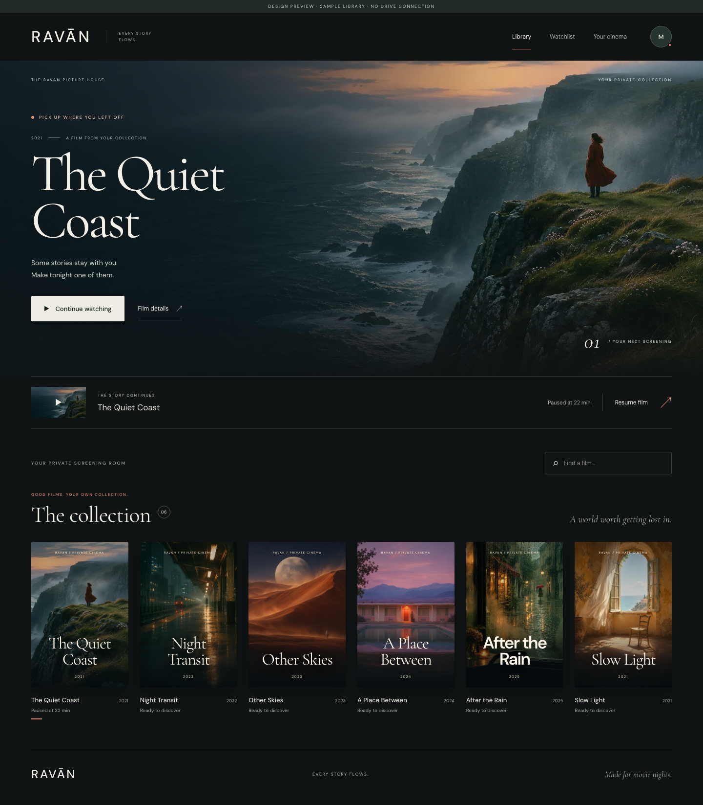

# RAVĀN

**Every Story Flows.** A private cinema for your own Google Drive movies, with a custom TypeScript backend, a React browser client, and an experimental LG C1 client.

## What works

- Google sign-in restricted to one owner, authenticator MFA, recovery codes, and revocable device pairing.
- Folder-scoped library discovery over read-only Google Drive access.
- Browsing by folder: each folder in the Drive folder, such as a series with its episodes, shows as one card that opens to its own films. A search from the top looks through every folder.
- Automatic browser compatibility, by what your browser reports it can play: the original directly (MP4, WebM or Matroska; H.264, HEVC including HDR, AV1, VP9), a repackaged copy with the picture untouched, or H.264/AAC conversion. HDR10/HLG sources become SDR editions only for browsers that cannot decode them.
- Series: films named as episodes in Drive (`Show - S03E01`) know the next one in their folder. Near the end of an episode the next one is offered, and at the end it plays after a ten-second count that can be stopped, or turned off for good in Settings. Titles follow renames in Drive until you edit them in RAVAN.
- RAVAN's own player controls in every browser: a seek line drawn as the copper line of the wordmark, a click in the middle of the picture to play or pause, a paused film shown as an intermission with its title and the time to go, picture in picture where offered, and full screen that keeps the menus and the next-episode panel.
- Quality choices from 480p to 4K without upscaling, multiple audio choices, up to 64 text-subtitle tracks, seeking, watchlists, and saved playback position.
- Private media tickets, byte-range delivery, encrypted metadata backups, and bounded background processing on a CPU-only server.
- A browser reading room for EPUB books, PDF documents and CBZ manga from the connected Google Drive folder, with search, saved position, text sizing and right-to-left navigation. See [reader usage and format limits](docs/reading-room.md).

The browser is the primary supported client. A film your browser can decode plays at once, or within the first segments of a repackaging pass. A film it cannot decode is converted, and can be watched while it is converted as soon as the converter is sure to stay ahead of you; a slow 4K HDR conversion starts part-way through rather than at once. Conversion targets up to 1080p unless the picture is kept as it is; cinematic aspect ratios can produce a lower output height. This is not adaptive bitrate streaming. Encrypted files, damaged sources, unavailable decoders, image subtitles, and Dolby Vision-only files remain limitations. On an LG C1, the web client runs in the TV's own browser (webOS 6, Chromium 79) and plays films; the owner confirmed this on the TV on 22 November 2026. PDF books there need a phone or computer. The packaged TV app is not yet verified on the TV.



## Run locally

Requires Node 24.21 or a newer Node 24 patch, npm, FFmpeg and FFprobe. HDR conversion requires FFmpeg built with `zscale` and `tonemap`.

```sh
npm ci
npm run dev:api
npm run dev:web
```

Open `http://localhost:5173`. The fictional preview is at `http://localhost:5173/?preview=1`; it does not grant API access or include personal movie files.

To connect Google Drive, configure the owner and private environment as described in [backend setup](docs/backend-usage.md). See [MFA and recovery](docs/security/mfa-usage.md). Start the worker with the same private environment as the API.

For the experimental TV layout:

```sh
npm run dev:tv
```

Open `http://localhost:5174/?preview=1`. Arrow keys navigate, Enter selects, and Escape returns. See [TV installation](docs/tv-installation.md).

## Verify

```sh
npm run check
npm test
npm run build
npm run build:web
npm run build:tv
npm run fixtures
npx playwright install chromium firefox webkit
npm run test:e2e
```

The local suite currently has 337 passing tests and one conditional HDR skip when `zscale` is absent; one of them runs the real API, worker and FFmpeg end to end. The browser suite has 153 tests across Chromium, Firefox and WebKit. Production FFmpeg tests cover 64 subtitle outputs under the worker task limit and a real HDR sample with 38 subtitle tracks. These results do not imply that every file or physical television is supported.

## Deploy

The API and media worker run on a private Linux origin; Cloudflare serves the frontend and redirects media to the authenticated origin. Set your own public and media hostnames in the Wrangler configuration, Nginx template, and build-time Content Security Policy. Store the origin token using Wrangler secrets, never in source.

```sh
npm run build:cloudflare
CLOUDFLARE_ACCOUNT_ID=<your-account-id> npm run deploy:cloudflare
```

Commit before building. Deployment checks the clean Git revision and asset checksums. The production preparation directory must be a separate bounded filesystem; the supplied service templates use a 20 GiB volume, a 2 GiB worker memory ceiling, one CPU core and 256 tasks. FFmpeg uses multiple tasks even when video encoding uses one thread, especially with many subtitles.


Never publish populated `.env` files, OAuth client JSON, database files, MFA material, server keys, movie files, or private backups. Generated demonstration artwork is fictional. Personal runtime data belongs outside the source repository.
